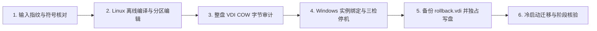

<h1 align="center">MuMu ReSukiSU</h1>

<p align="center">
  <strong>面向固定 MuMu 引擎的 Root 适配、离线构建与可回退安装工具</strong>
</p>

<p align="center">
  <a href="pyproject.toml"></a>
  <a href="THIRD_PARTY.md"></a>
</p>

<p align="center">
  <a href="https://mumu-resukisu.cbnv.me/docs/">在线文档站</a> · <a href="docs-site/api-reference/index.md">API 与 CLI 参考</a> · <a href="docs-site/en/index.md">English Docs</a> · <a href="repo-docs/README.md">工程指南</a> · <a href="docs-site/docs/index.md">构建与操作</a> · <a href="docs-site/docs/validation.md">阶段验证</a>
</p>

面向指纹匹配的 **MuMu Android 15 `x86_64`** 模拟器引擎，提供离线的 ReSukiSU 内核模块与用户态工具构建、整盘 VDI COW 字节审计与 Windows 独占句柄单实例可回退安装流程。

## 能力边界与明确非目标

- **能做到什么程度**：
  - 在 Linux/WSL 完成 `kernelsu.ko`（`vermagic=6.1.90-perf+ `、`235` 个外部符号核对）、`driver-init`、`resukisu-migrate-prestage` 及 `boot`/`system`/`vendor` 分区制备，并通过 ASAN/UBSAN 与 32 位宿主模型测试；
  - 跨平台按 VDI 1 MiB COW 语义重读全部 `2,465,270,784` 虚拟字节证明零越界写入；Windows 端确认三次停机与内置 Root 关闭后经 `CreateFileW(share=0)` 写入并支持凭 `rollback.vdi` 原盘恢复。
- **明确不做什么**：
  - **仅支持唯一固定指纹快照**：不支持 Android 12 或未知 MuMu 版本；严禁修改摘要跳过校验，也不支持 `supported-daemons.json` 之外的未知/32 位 daemon；
  - **不分发镜像且 `refactoredDeviceValidation` 仍为 `false`**：仓库不含原盘/内核/APK；Linux 下 `unittest` 跳过 `29` 项 Win32 锁用例；`fetch-release` 与 `register-release.py`（`catalogUpdated: false`）不会自动升级固定构建目标；
  - **写盘不自动重启、恢复不动 `/data`**：`scripts/build-frida.py` 仅作可选实验辅助脚本；全命令参数见 [API 与 CLI 参考](docs-site/api-reference/index.md)。

## 核心能力与执行流

- **固定目标指纹门禁**：`extract` 与 `assemble` 核对基础盘 SHA256、`2,465,270,784` 逻辑容量、`boot`/`system`/`vendor` 分区摘要及 `235` 个内核符号集合，拒绝未指纹化引擎。
- **跨平台离线分区构建**：在 Linux/WSL 下基于固定上游 Git 提交导出并编译 `kernelsu.ko`、`driver-init` 与 `resukisu-migrate-prestage`，分区编辑限制在原数据槽与固定节点范围内。
- **整盘 VDI COW 字节审计**：按 1 MiB 父盘/差分盘/零块/未分配块语义重读全部虚拟字节，保证允许分区之外零越界修改。
- **单实例绑定与可回退写盘**：Windows 控制器确认三次连续停机与内置 Root 关闭后获取 `CreateFileW` 独占锁，先持久化 `rollback.vdi` 原盘备份，支持按事务号还原私有系统盘（不改动 `/data`）。
- **原厂迁移与发行通道隔离**：`resukisu-migrate-prestage` 仅对精准匹配 `3,753,880` 字节的原厂 `/system/xbin/dusk` 在 `/data` 完成持久备份后再迁移；`fetch-release` 与 `register-release.py` 均不自动修改固定构建目标。



## 快速起步

在 Python 3.11+ 环境安装可编辑包，运行跨平台主机校验与目标档案检查（不修改任何模拟器磁盘）：

```sh
python -m pip install -e .
python -m unittest discover -s tests -v
mumu-resukisu profile --profile targets/mumu-android15-x86_64/profile.json
```

本地安全隔离约定（详见 [输入契约与配置参数](docs-site/docs/configuration.md)）：

- 原始磁盘快照、内核源码、管理器 APK 与下载归档一律放在受 Git 忽略的 `inputs/` 与 `build/`；
- 实例绑定档案、`bindings/userspace.json` 与旁侧 `.state/<sha256>/` 原盘备份必须成对保留且禁止提交；
- Linux 上执行 `unittest` 会跳过 29 项依赖 Win32 独占句柄与锁定 API 的测试用例，完整写盘矩阵需在 Windows 验证。

完整构建、组装与写盘入口按平台拆分，请按场景跳转：

| 使用场景 | 运行平台 | 核心入口 | 详细文档 |
| --- | --- | --- | --- |
| 原生模块、内核、预置工具与三分区构建 | Linux / WSL | `scripts/build-native.py`、`build-userspace.py`、`prepare-*.py` | [完整构建流程](docs-site/docs/index.md) |
| 差分盘提取、整盘重组与字节审计 | Linux / Windows | `mumu-resukisu extract` / `assemble` / `audit` | [输入契约与 CLI 矩阵](docs-site/docs/configuration.md) |
| 单实例绑定、独占写盘与事务回退 | Windows | `mumu-resukisu bind` / `inspect` / `install` / `status` / `restore` | [镜像变化与恢复边界](docs-site/docs/image-boundaries.md) |
| 上游版本查询下载与离线待审登记 | 跨平台 / Linux | `mumu-resukisu fetch-release`、`scripts/register-release.py` | [发行版生命周期](docs-site/docs/release-lifecycle.md) |
| 架构全景、三域边界与可选 Frida 构建 | Linux / NDK | `scripts/build-frida.py`（未迁入通用附加入口） | [系统架构与交互全景](docs-site/docs/architecture.md) |

## 选型与边界 FAQ

- **支持 Android 12、其他 MuMu 版本或通用手机内核吗？**
  不支持。主流程与原生构建仅锁死指纹匹配的 MuMu Android 15 `x86_64` 目标快照；版本号字符串相同但签名或容量不匹配仍会被拒绝，严禁通过改写摘要放行未知版本。

- **为什么构建阶段与写盘阶段要分在 Linux 和 Windows？**
  内核模块编译、`libext2fs` 编辑与 ASAN/UBSAN 宿主模型依赖 Linux/WSL 工具链，而 `MuMuManager.exe` 实时查询及 `CreateFileW` 共享模式 `0` 独占写锁只在 Windows 主机运行；两阶段通过经整盘审计的 `candidate.json` 交接。

- **执行 `fetch-release` 或 `register-release` 会自动启用新版 ReSukiSU 吗？**
  不会。下载与登记仅输出隔离的待审清单（`catalogUpdated: false`），固定构建提交与支持 daemon 清单（`supported-daemons.json`）必须经过补丁审查与实机检验后通过代码更新。

- **`restore` 回退系统盘会清掉管理器授权或 `/data` 上的原厂备份吗？**
  不会。原厂 `/system/xbin/dusk` 持久备份与授权数据库存放在 `/data`，`restore` 仅依赖事务备份逐字节还原私有系统差分盘 `system-diff.vdi`；当前 `refactoredDeviceValidation` 仍为 `false`，三阶段脚本生命周期与 32 位 daemon 尚未验收。

## 阅读路径

| 你的目标 | 文档站专题 | 工程指南深入入口 |
| --- | --- | --- |
| 准备本地输入、依赖工具并走完构建写入 | [项目全貌与完整构建流程](docs-site/docs/index.md) | [一次可回退安装全流程](repo-docs/walkthroughs/one-real-run.md) |
| 查阅 `profile.json`、`userspace.json` 与脚本参数 | [输入契约、配置与脚本参数](docs-site/docs/configuration.md) · [API 与 CLI 参考](docs-site/api-reference/index.md) | [代码地图](repo-docs/code-map.md) |
| 查看三域拓扑交互图与安全边界假设 | [系统架构与数据流全景](docs-site/docs/architecture.md) | [镜像变化与恢复边界](repo-docs/modules/image-boundaries.md) |
| 排查指纹报错、写锁冲突或 Linux 用例跳过 | [常见问题与排错诊断](docs-site/docs/faq.md) | [文档质量复核](repo-docs/references/quality-review.md) |
| 核对各阶段实测范围、未覆盖项与源码台账 | [阶段验证与架构决策](docs-site/docs/validation.md) | [源码证据台账](repo-docs/references/source-evidence.md) |

## 许可与致谢

- **混合许可证说明**：独立工具脚本、主机控制器与文档采用 **AGPLv3**（见 [LICENSE](LICENSE)）；`native/driver/` 衍生内核补丁与 `native/images/system-edit.c` 保留 **GPLv2-only**。完整组件归属与限制见 [THIRD_PARTY.md](THIRD_PARTY.md) 与 [SECURITY.md](SECURITY.md)。
- **上游来源**：衍生原生补丁基线源自 `ReSukiSU/ReSukiSU`（官方发布已迁移至 `Baka-SU/BakaSU`）及 Android Common Kernel（ACK）。本项目不分发原始内核、模拟器磁盘镜像或第三方 APK；贡献流程与测试约定见 [CONTRIBUTING.md](CONTRIBUTING.md) 与 [AGENTS.md](AGENTS.md)。
- **安全红线**：严格隔离受忽略目录 `.local/`、`inputs/`、`build/`、`bindings/` 与 `.state/`，禁止将个人实例身份、原始镜像或本机运行日志提交至公开仓库。

- **附加条款与资产规则**：本项目依据 GNU AGPLv3 第 7 条适用 [`LICENSE-ADDITIONAL_TERMS-zh-CN.md`](LICENSE-ADDITIONAL_TERMS-zh-CN.md)（英文参考译文：[`LICENSE-ADDITIONAL_TERMS-en.md`](LICENSE-ADDITIONAL_TERMS-en.md)，以简体中文完整版正文为准），对来源陈述、修改标识、禁止冒充、扩展模块有条件附加许可及项目标识边界作出补充说明；独立美术、字体与图标许可清单见 [`ASSET_LICENSES.md`](ASSET_LICENSES.md)。第 9.5–9.6 款的附加许可豁免仅对已取得相应版权持有人有效授权的适用材料生效，未取得该等授权的第三方或上游材料仍受其原有有效许可约束。
